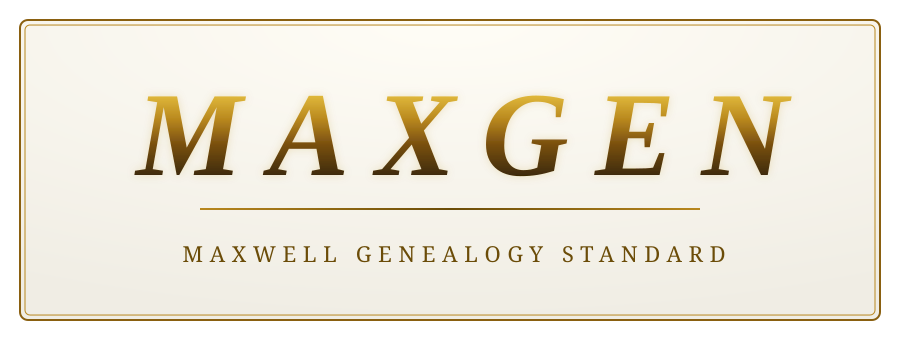

An open standard · public domain · current release v<!--CURRENT-->

<h1>Genealogy data that is honest about what it doesn't know.</h1>

MAXGEN is a free, open data standard for family history. Every fact carries its source and a confidence score. Conflicting evidence is kept, not deleted. Anyone can use it, build on it, or extend it. No permission required.

<a href="/standard/"><strong>Read</strong>What the standard is and why it exists</a>
<a href="/podcasts/"><strong>Listen</strong>Eight podcast episodes, recorded for v1.11</a>
<a href="/schemas/"><strong>Download</strong>The twelve schema files, every version</a>

## The problem it solves

Genealogy has never had more to work with. Close to two billion records are online, archives scan more every year, volunteers transcribe registers by the million, and DNA testing has added a whole new kind of evidence. The formats we exchange that work in were designed for a simpler time: one birth year, one birthplace, one set of parents, written down as settled fact. Real family history rarely arrives that clean. A census says 1843; a gravestone says 1844. A father could be one of three men with the same name.

MAXGEN writes the doubt down. It stores **what the document says** separately from **what we think it means**, keeps every claim with its source and a 0-to-1 confidence score, and never overwrites anything. Several possible parents can coexist until the evidence resolves them. Every uncertainty becomes a lead worth chasing instead of a dead end, and as each new source corroborates a name or a date you watch the evidence for it grow. People can read it, researchers can check it, and AI can work with it without inventing anything, because confidence is a machine's native language.

MAXGEN is built to sit alongside the archives, record sites, and communities researchers already rely on, not to replace them. It is a shared language they can all speak. Every ancestor. Every source. Every honest doubt.

## The eleven record schemas

A schema is a written rule-set that says exactly what fields a record has and what each one means, so that any program can read a record written by any other program. Since version 2.0, MAXGEN has eleven record schemas, plus one shared file of building blocks that they all use, and each record schema has its own page.

<!--CARDS-->

## Three promises

1. **Nothing is ever deleted.** A retracted claim gets a retraction note; it does not vanish. The audit trail is permanent.
2. **Living people are protected by the schema itself.** A record about a person who may be alive is locked private no matter what any application does.
3. **Records stay valid within a major version.** Within 2.x every change is additive: fields are never renamed or removed, and a file valid under 2.0 stays valid under every 2.x release. See the [changelog](/changelog/).

## Who it is for

- **Developers** building genealogy tools or AI agents: twelve JSON Schema files (eleven record schemas and one shared file) at stable addresses, a changelog, made-up examples, and a [validator](/validator/) that runs in your browser.
- **Genealogists and archivists** deciding whether to trust it: the [plain-English guide](/standard/), the [FAQ](/faq/), and the [podcasts](/podcasts/).
- **Institutions** who need to know how it is governed before adopting it: the [governance page](/governance/) and the [licence](/license/).

MAXGEN is short for the Maxwell Genealogy Standard, named for its author, Garlon Maxwell. It is stewarded by OpenGenealogyAI and dedicated to the public domain (CC0).

